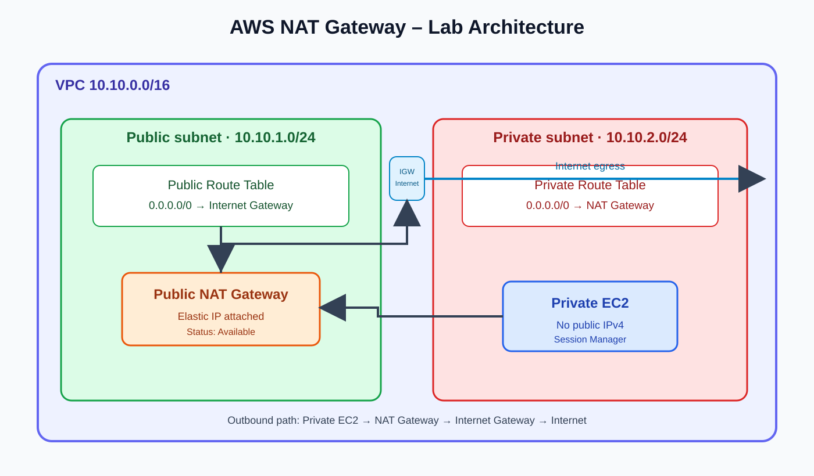
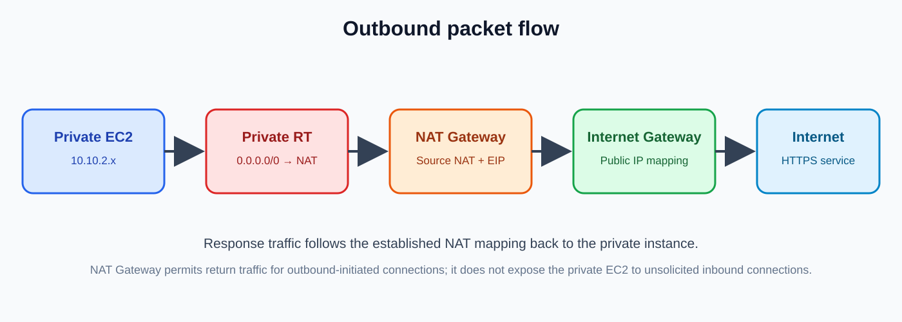

# AWS NAT Gateway – Complete Practical Lab (2026 Console)

A beginner-friendly, console-first lab for teaching how a **public NAT Gateway** gives instances in a private subnet outbound IPv4 internet access without assigning those instances public IP addresses.

> **Service clarification:** This repository teaches an AWS **NAT Gateway**, not a self-managed NAT instance. AWS manages the gateway. You do not install Linux packages, enable IP forwarding, or disable source/destination checks.

## Learning outcomes

By completing this lab, students will be able to:

1. Explain public subnet vs private subnet.
2. Create a VPC with public and private subnets.
3. Attach an Internet Gateway (IGW).
4. Create a public NAT Gateway and associate an Elastic IP (EIP).
5. Configure public and private route tables correctly.
6. Launch a private EC2 instance without a public IPv4 address.
7. Connect to the private instance using Systems Manager Session Manager.
8. Test outbound internet connectivity and troubleshoot common failures.
9. Clean up resources to avoid ongoing charges.

## Architecture



Traffic path:

`Private EC2 → Private route table (0.0.0.0/0 → NAT Gateway) → NAT Gateway → Public route table (0.0.0.0/0 → IGW) → Internet`

The NAT Gateway must be placed in a **public subnet**. Its subnet route table must have a default route to an Internet Gateway. The private subnet route table must have a default route to the NAT Gateway.

## Lab plan and example values

Use a unique name prefix if multiple students share an AWS account. These are example values; choose a CIDR range that does not overlap with existing networks.

| Resource | Example |
|---|---|
| Region | ap-south-1 (Mumbai) |
| VPC | `10.10.0.0/16` |
| Public subnet | `10.10.1.0/24` |
| Private subnet | `10.10.2.0/24` |
| Availability Zone | One AZ for this introductory zonal lab |
| Public route table | `0.0.0.0/0 → Internet Gateway` |
| Private route table | `0.0.0.0/0 → NAT Gateway` |
| NAT Gateway | Public, Zonal |
| NAT EIP | Allocate a new Elastic IP |
| Private EC2 | Amazon Linux 2023, no public IP |
| Private EC2 access | Systems Manager Session Manager |

**Cost warning:** NAT Gateways are billed while provisioned, plus data processing and applicable data transfer charges. Elastic IP/public IPv4 charges may also apply. Create this only in a training account, monitor Billing, and delete it immediately after the lab. Check current regional pricing before starting.

## Prerequisites

- AWS account with permission to manage VPC, EC2, IAM roles, Elastic IPs, and Systems Manager.
- Select one AWS Region and keep all resources in that Region.
- Use an IAM role/user with least-privilege permissions. Do not use root credentials for routine work.
- For Session Manager, the private EC2 instance needs an instance profile containing `AmazonSSMManagedInstanceCore`.
- The lab uses IPv4. IPv6 egress requires a different design (for example, an egress-only Internet Gateway).

---

# Part 1 – Create the VPC and subnets

1. Sign in to the AWS Management Console.
2. In the top search bar, search for **VPC** and open the VPC console.
3. Confirm the Region in the top-right corner (example: Asia Pacific (Mumbai), `ap-south-1`).
4. In the navigation pane, open **Your VPCs** and choose **Create VPC**.
5. For **Resources to create**, select **VPC and more**.
6. Set:
   - Name tag: `nat-lab`
   - IPv4 CIDR: `10.10.0.0/16`
   - Number of Availability Zones: `1`
   - Number of public subnets: `1`
   - Number of private subnets: `1`
   - NAT gateways: **None** (we will create one manually to learn each step)
   - VPC endpoints: None for this introductory lab
7. Review the preview and choose **Create VPC**.
8. Wait until creation completes. Open the VPC and record its VPC ID.
9. Open **Subnets** and record the public and private subnet IDs. Confirm both belong to the new VPC.

Expected CIDRs:
- Public subnet: `10.10.1.0/24`
- Private subnet: `10.10.2.0/24`

If the wizard generates different subnet CIDRs, use the actual values consistently in the rest of the lab.

**Console screenshot to add:** `screenshots/01-create-vpc.png` – VPC and more form showing the VPC CIDR, one AZ, one public subnet, one private subnet, and NAT gateways set to None.

# Part 2 – Create and attach an Internet Gateway

1. In VPC console, open **Internet gateways**.
2. Choose **Create internet gateway**.
3. Name it `nat-lab-igw`, then choose **Create internet gateway**.
4. Select the new gateway.
5. Choose **Actions → Attach to a VPC**.
6. Select the `nat-lab` VPC and attach it.
7. Confirm the state is **Attached**.

**Why?** A public subnet needs a route to an Internet Gateway. Merely creating a subnet does not make it public.

**Console screenshot to add:** `screenshots/02-internet-gateway-attached.png` – IGW details showing the attached VPC.

# Part 3 – Configure the public route table

1. Open **Route tables** in the VPC console.
2. Identify the route table associated with the public subnet. If you used the VPC wizard, it may have created one automatically.
3. Select it and inspect the **Subnet associations** tab. Confirm the public subnet is associated.
4. Open the **Routes** tab and choose **Edit routes**.
5. Add or confirm these routes:

| Destination | Target |
|---|---|
| `10.10.0.0/16` | `local` |
| `0.0.0.0/0` | Your Internet Gateway (`igw-...`) |

6. Save changes.

Do not point the public route table to the NAT Gateway. The NAT Gateway itself needs the Internet Gateway route.

**Console screenshot to add:** `screenshots/03-public-route-table.png` – Routes tab showing local and `0.0.0.0/0 → igw-...`.

# Part 4 – Allocate an Elastic IP

1. In the VPC console, open **Elastic IPs** (or use the EC2 console's Elastic IPs page).
2. Choose **Allocate Elastic IP address**.
3. Keep the standard Amazon IPv4 address pool selection unless your organization requires otherwise.
4. Choose **Allocate**.
5. Record the Allocation ID (`eipalloc-...`). You will select this when creating the NAT Gateway.

An Elastic IP is required for a public NAT Gateway. Be aware that public IPv4 addresses can incur charges.

**Console screenshot to add:** `screenshots/04-elastic-ip.png` – Allocated EIP with its Allocation ID (blur account-specific information if sharing publicly).

# Part 5 – Create the public NAT Gateway (2026 console)

1. In the VPC console navigation pane, choose **NAT gateways**.
2. Choose **Create NAT gateway**.
3. Enter:
   - Name: `nat-lab-public-ngw`
   - Subnet: the **public subnet** (`10.10.1.0/24`)
   - Connectivity type: **Public**
   - Elastic IP allocation ID: select the EIP allocated in Part 4
4. If the current console presents an **Availability mode** choice, select **Zonal** for this one-AZ introductory exercise. The console's available options can vary by Region and feature rollout. Regional NAT Gateway is a separate option; see the note below.
5. Review and choose **Create NAT gateway**.
6. Open **NAT gateways** and wait for status **Available**. Do not configure the private route until the NAT Gateway is Available.
7. Record the NAT Gateway ID (`nat-...`) and its subnet.

**Critical:** The selected subnet must be the public subnet whose route table has `0.0.0.0/0 → igw-...`.

**Console screenshot to add:** `screenshots/05-create-nat-gateway.png` – Create NAT gateway form with name, public subnet, Public connectivity, and EIP selection.  
**Console screenshot to add:** `screenshots/06-nat-gateway-available.png` – NAT Gateway details showing Available status and subnet.

### Zonal vs Regional NAT Gateway

For this lab, use **Zonal** so students can clearly see the NAT Gateway placed in one public subnet/AZ and route the private subnet through it. AWS also offers Regional NAT Gateway in supported Regions. Regional mode has a different creation and routing workflow; do not mix its instructions with this Zonal lab. See AWS's current NAT Gateway documentation and Regional NAT Gateway announcement in References.

# Part 6 – Create the private route table

1. Open **Route tables**.
2. Choose **Create route table**.
3. Name: `nat-lab-private-rt`.
4. VPC: select `nat-lab`.
5. Choose **Create route table**.
6. Select the new route table and open **Subnet associations**.
7. Choose **Edit subnet associations**.
8. Select only the private subnet (`10.10.2.0/24`) and save.
9. Open the **Routes** tab and choose **Edit routes**.
10. Add:

| Destination | Target |
|---|---|
| `10.10.0.0/16` | `local` |
| `0.0.0.0/0` | NAT Gateway (`nat-...`) |

11. Save changes.

**This is the key NAT configuration.** The private subnet's default route points to the NAT Gateway, not directly to the Internet Gateway.

**Console screenshot to add:** `screenshots/07-private-route-table.png` – Subnet association and Routes tab showing `0.0.0.0/0 → nat-...`.

# Part 7 – Create an IAM role for Systems Manager

We will connect to the private EC2 instance with Session Manager. This avoids assigning a public IP or opening SSH to the internet.

1. Open the **IAM** console.
2. Choose **Roles → Create role**.
3. Trusted entity type: **AWS service**.
4. Use case: **EC2**.
5. Add the AWS managed policy **AmazonSSMManagedInstanceCore**.
6. Role name: `nat-lab-ec2-ssm-role`.
7. Create the role.

Follow your organization's IAM policy standards. Do not attach broad administrator permissions to the EC2 instance.

# Part 8 – Launch a private EC2 instance

1. Open the **EC2** console and choose **Instances → Launch instances**.
2. Name: `nat-lab-private-ec2`.
3. AMI: **Amazon Linux 2023**.
4. Instance type: choose a small type available in your Region (for example, `t3.micro`, subject to account eligibility and current pricing).
5. Key pair: not required for Session Manager-only access; follow your organization's policy.
6. Under **Network settings**, choose **Edit**:
   - VPC: `nat-lab`
   - Subnet: the private subnet (`10.10.2.0/24`)
   - Auto-assign public IP: **Disable**
   - Create/select a security group such as `nat-lab-private-sg`
7. Security group inbound rules: no inbound SSH rule is needed for this Session Manager lab.
8. Security group outbound: allow TCP 443 to `0.0.0.0/0` for this basic test. In production, restrict egress to required destinations where feasible.
9. Under **Advanced details → IAM instance profile**, select `nat-lab-ec2-ssm-role`.
10. Launch the instance.
11. Wait for instance state **Running** and status checks **2/2 passed**.
12. In instance details, confirm **Public IPv4 address** is blank.

**Console screenshot to add:** `screenshots/08-launch-private-ec2.png` – Network settings showing private subnet and Auto-assign public IP disabled.  
**Console screenshot to add:** `screenshots/09-private-ec2-running.png` – Instance details showing Running and no public IPv4 address.

# Part 9 – Connect using Session Manager

1. In EC2 → Instances, select `nat-lab-private-ec2`.
2. Choose **Connect**.
3. Open the **Session Manager** tab.
4. Choose **Connect**.
5. If the session cannot start immediately, wait a few minutes and verify the SSM prerequisites in Troubleshooting.

Session Manager requires the SSM Agent to be running, the instance profile to be attached, and network connectivity to the Systems Manager service endpoints. In this lab, the private instance reaches the public Systems Manager endpoints through the NAT Gateway.

**Console screenshot to add:** `screenshots/10-session-manager.png` – Successful Session Manager terminal (hide account identifiers).

# Part 10 – Test internet access from the private EC2

Run these commands in the Session Manager shell:

```bash
# Confirm the operating system
cat /etc/os-release

# Confirm there is no public IPv4 address assigned
ip -4 addr

# Check DNS resolution
getent hosts amazon.com

# Test outbound HTTPS
curl -I --connect-timeout 10 https://amazon.com

# Show the public egress IP observed by an external service
curl -4 https://checkip.amazonaws.com
```

Expected results:
- DNS lookup returns one or more IP addresses.
- `curl -I` returns an HTTP response (a redirect such as 301/302 is acceptable).
- The checkip command returns the NAT Gateway's Elastic IP (not an EC2 public IP).

If `curl` is not installed, Amazon Linux 2023 normally includes it; if not, install it after connectivity is working.

**Console screenshot to add:** `screenshots/11-connectivity-test.png` – Terminal output showing successful HTTPS and the NAT EIP.

# Part 11 – Understand the packet path



1. The private EC2 sends a packet to an internet destination.
2. The private subnet route table matches `0.0.0.0/0` and forwards it to the NAT Gateway.
3. The NAT Gateway translates the source address/port for outbound communication.
4. The public subnet route table sends the packet to the Internet Gateway.
5. The Internet Gateway maps the NAT Gateway's private IPv4 address to its Elastic IP for internet communication.
6. Response traffic returns through the NAT Gateway, which maps it back to the originating private instance.

A public NAT Gateway allows outbound-initiated connections and their responses. It does **not** make the private EC2 instance directly reachable for unsolicited inbound internet connections.

# Part 12 – Troubleshooting checklist

| Symptom | What to verify |
|---|---|
| NAT Gateway stuck in Pending | Wait; check subnet, EIP availability, quotas, and VPC events/status |
| NAT Gateway Failed | Inspect NAT Gateway details and AWS VPC troubleshooting guidance |
| Private EC2 has no internet | Private route table is associated with the correct private subnet |
| Route is blackhole | NAT Gateway may have been deleted or is not a valid target |
| NAT Gateway cannot reach internet | Public subnet route table has `0.0.0.0/0 → igw-...`; IGW is attached |
| DNS fails | VPC DNS resolution/hostnames settings, DHCP options, and resolver reachability |
| HTTPS times out | NAT status, both route tables, NACL return ephemeral ports, SG egress TCP 443 |
| Session Manager offline | Instance profile, SSM Agent, DNS, NAT route, and outbound HTTPS to SSM endpoints |
| EC2 got a public IP | Recheck subnet launch setting and instance network interface; remove public exposure if not required |

Remember:
- Security groups are stateful.
- Network ACLs are stateless; custom NACLs must allow request and response traffic, including ephemeral return ports.
- A NAT Gateway does not need a security group.
- NAT Gateway is not a replacement for an inbound bastion host or VPN.
- A NAT Gateway handles IPv4. Do not expect `0.0.0.0/0` to provide IPv6 egress.

# Part 13 – Cleanup (important)

Delete resources in a safe order after capturing evidence:

1. Terminate `nat-lab-private-ec2`.
2. Delete the NAT Gateway. Wait until deletion completes.
3. Release the Elastic IP if it is no longer needed (EC2 → Network & Security → Elastic IPs → select EIP → Actions → Release Elastic IP addresses).
4. Delete the private route table (after disassociating it if needed).
5. Delete the Internet Gateway (detach it from the VPC first).
6. Delete the VPC (the VPC console may require remaining subnets and route tables to be removed first).
7. Delete the IAM role if it was created only for this lab.

Do not release an EIP that is still attached to a resource you need. Verify the resource names and IDs before deleting.

# Student submission checklist

- [ ] VPC ID and CIDR recorded
- [ ] Public and private subnet IDs recorded
- [ ] Internet Gateway attached
- [ ] Public route table has `0.0.0.0/0 → IGW`
- [ ] NAT Gateway status is Available
- [ ] NAT Gateway is in the public subnet and has an EIP
- [ ] Private route table has `0.0.0.0/0 → NAT Gateway`
- [ ] Private EC2 has no public IPv4 address
- [ ] Session Manager connection successful
- [ ] `curl` to an HTTPS endpoint successful
- [ ] Egress IP equals NAT Gateway EIP
- [ ] All lab resources cleaned up

## Screenshot submission naming

Save your own screenshots in the `screenshots/` folder using the exact filenames listed in each part. Before publishing to a public GitHub repository, hide AWS account IDs, usernames, public IPs not intended for publication, resource ARNs, and any other sensitive details.

## References (AWS official)

- [Work with NAT gateways](https://docs.aws.amazon.com/vpc/latest/userguide/work-with-nat-gateway.html)
- [NAT gateways – concepts and connectivity types](https://docs.aws.amazon.com/vpc/latest/userguide/vpc-nat-gateway.html)
- [Create a VPC](https://docs.aws.amazon.com/vpc/latest/userguide/create-vpc.html)
- [Enable private resources to communicate outside the VPC using NAT instances](https://docs.aws.amazon.com/vpc/latest/userguide/work-with-nat-instances.html) – useful comparison; this repository does **not** build a NAT instance.
- [Introducing Amazon VPC Regional NAT Gateway](https://aws.amazon.com/blogs/networking-and-content-delivery/introducing-amazon-vpc-regional-nat-gateway/)
- [AWS Systems Manager – Session Manager](https://docs.aws.amazon.com/systems-manager/latest/userguide/session-manager.html)
- [Amazon EC2 pricing](https://aws.amazon.com/ec2/pricing/)
- [Amazon VPC pricing](https://aws.amazon.com/vpc/pricing/)

## Suggested instructor questions

1. Why must the NAT Gateway be in a public subnet?
2. Why does the private EC2 instance not need a public IP?
3. What is the difference between the public and private route table default routes?
4. Why is an Elastic IP required for a public NAT Gateway?
5. Can an internet user initiate a new connection to the private EC2 through the NAT Gateway?
6. What happens if the NAT Gateway is deleted but the private route remains?
7. Why can a NAT Gateway increase monthly cost even when traffic is low?
8. When would VPC endpoints be preferable to NAT Gateway egress?

---
**Lab version:** 1.0  
**Console guidance:** Written for the AWS Management Console as of October 2026. AWS may change labels, layouts, and regional feature availability. Follow the resource relationships and route targets if a label differs.
